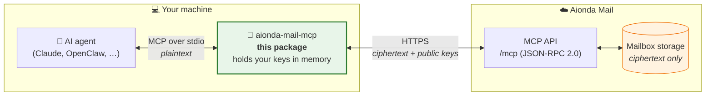
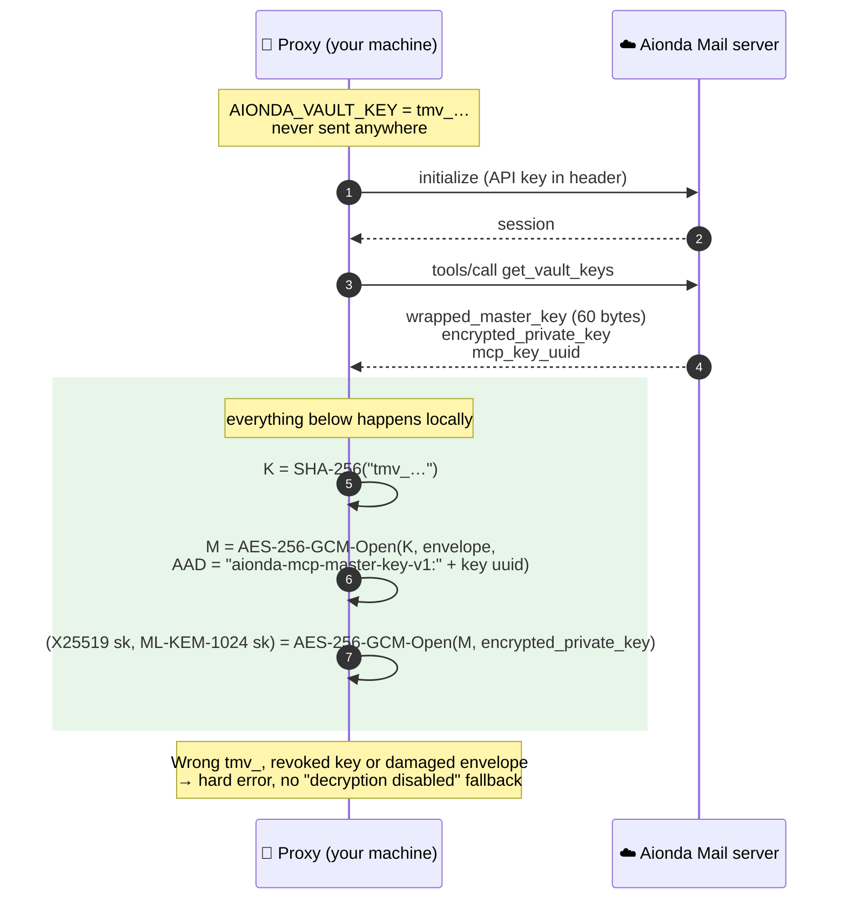
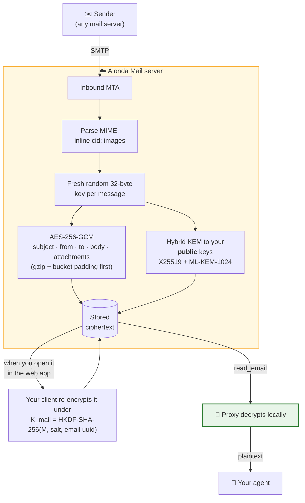
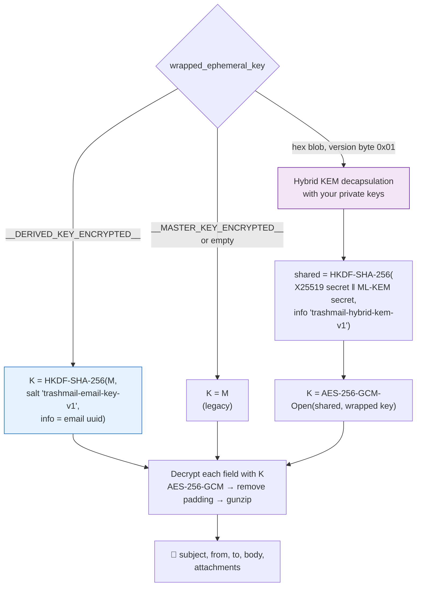
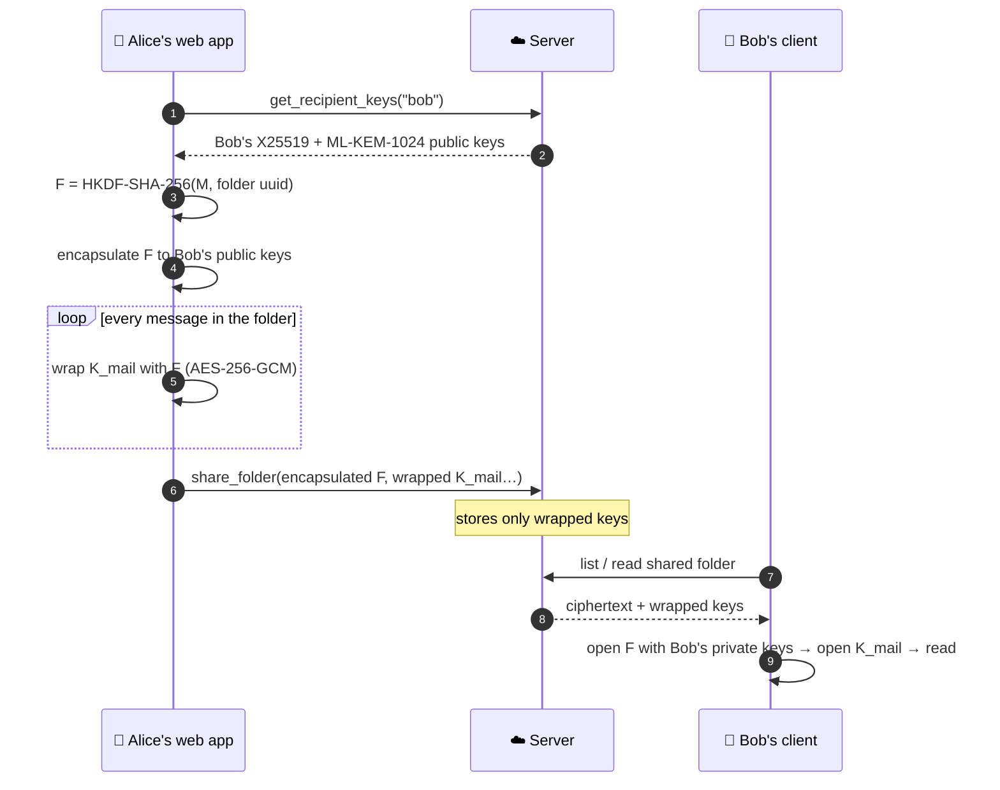

<p align="center">
  <a href="https://aionda.com">
    <picture>
      <source media="(prefers-color-scheme: dark)" srcset="https://raw.githubusercontent.com/AiondaDotCom/aionda-mail-mcp-client/main/assets/aionda-logo-white.png">
      
    </picture>
  </a>
</p>

<h1 align="center">Aionda Mail MCP Client</h1>

**Let AI agents work with your end-to-end encrypted mailbox without handing the keys to anyone else.**

[](https://www.npmjs.com/package/@aiondadotcom/mail-mcp-client)
[](https://github.com/AiondaDotCom/aionda-mail-mcp-client/actions/workflows/ci.yml)
[](LICENSE)


[Aionda Mail](https://mail.aionda.com) stores every message encrypted. The server
holds ciphertext and public keys. It never holds the key that opens your mailbox.

This package is the piece that makes that work with AI. It runs **on your own
machine**, speaks the [Model Context Protocol](https://modelcontextprotocol.io)
to your agent (Claude Code, Claude Desktop, OpenClaw, Cursor, …) and the Aionda
Mail MCP API to the server. Everything you read is decrypted locally. Folder
names, calendar entries and tasks you create are encrypted locally before they
leave. Mail you **send** and drafts you save go to the server readable, so it
can deliver them (see [Security model](#security-model-honestly)).

We publish it as open source so you don't have to take that on trust. Read the
code, run the tests and check the known-answer vectors yourself.

---

## How it works at a glance



| Where | What is visible there |
|---|---|
| Your agent ↔ proxy (stdio, local process) | Plaintext: the agent asked for it, so it gets it |
| Proxy ↔ server (HTTPS) | Ciphertext, wrapped keys, public keys, metadata such as dates and sizes (sizes are padded to buckets) |
| Server storage | Ciphertext only. **No master key, no private key, no folder names in clear** |

---

## 1. Unlocking: from `tmv_…` to your mailbox keys

You configure two secrets: an API key (`tma_…` / `tmmcp_…`) that authenticates
you, and a vault key (`tmv_…`) that only ever stays on your machine. The server
stores a **hash** of the API key and an **envelope** it cannot open.



`M` is your **vault master key**, the same 32 bytes your browser and the native
apps reconstruct when you unlock your mailbox. The private keys belong to your
post-quantum key pair.

> **AI employees** (agent accounts created in the web manager) use the older
> scheme `M = SHA-256("tmv_…")` without an envelope. The proxy picks the right
> path from the server response; the code is in [`src/proxy.ts`](src/proxy.ts).

---

## 2. The life of an e-mail



A message arrives over SMTP in clear, as all Internet mail does. The server
encrypts it **on receipt** for your public keys and does not keep the
plaintext. From then on only your keys open it.

The web app then migrates each message you open to its **own derived key**
`K_mail = HKDF(M, uuid)`. Sharing a folder then hands out per-message keys,
never your master key. HKDF only goes one way: there is no path from `K_mail`
back to `M`.

### Which key opens a message?

Every message and attachment carries a `wrapped_ephemeral_key` field. The proxy
resolves it in **one** place ([`resolveContentKey`](src/crypto/email-decryptor.ts)):



Attachments always use **their message's** key. AES-GCM is authenticated, so a
wrong key or wrong byte layout fails loudly instead of producing garbage.

---

## 3. Shared folders without sharing your vault

This is how sharing works in Aionda Mail (the web app sets up the share). The
proxy takes part when your agent reads a folder someone shared with you, or
delivers a mail into it with `deliver_to_shared_folder`.



Bob receives the key of that one folder and the per-message keys inside it.
HKDF only goes one way, so neither F nor any `K_mail` leads back to Alice's
master key. The server never sees any of these keys in clear.

---

## Quick start

### 1. Create your keys

In Aionda Mail open **Settings → MCP access** and create a personal key. Your
browser generates both secrets and shows them **once**:

* `AIONDA_API_KEY` = `tmmcp_…` (the server stores only its SHA-256)
* `AIONDA_VAULT_KEY` = `tmv_…` (the server stores only an envelope it cannot open)

### 2. Add the server to your agent

**Claude Code**

```bash
claude mcp add aionda-mail \
  -e AIONDA_API_KEY=tmmcp_... \
  -e AIONDA_VAULT_KEY=tmv_... \
  -- npx -y @aiondadotcom/mail-mcp-client
```

**Claude Desktop / any MCP host** (`mcpServers` section):

```json
{
  "mcpServers": {
    "aionda-mail": {
      "command": "npx",
      "args": ["-y", "@aiondadotcom/mail-mcp-client"],
      "env": {
        "AIONDA_API_KEY": "tmmcp_...",
        "AIONDA_VAULT_KEY": "tmv_...",
        "AIONDA_ENDPOINT": "https://mail.aionda.com"
      }
    }
  }
}
```

Then ask your agent something like *"What came in today that needs an answer?"*

**Requirements:** Node.js ≥ 18 (≥ 22 for real-time events without a polyfill).

### Using it as a library

```typescript
import { AiondaMailClient } from '@aiondadotcom/mail-mcp-client';

const client = new AiondaMailClient({
    apiKey: process.env.AIONDA_MCP_KEY!,     // tmmcp_… (personal) or tma_… (AI employee)
    vaultKey: process.env.AIONDA_VAULT_KEY!, // tmv_…
    endpoint: 'https://mail.aionda.com',
});

await client.connect();                      // fetches and unlocks the vault keys locally
const page = await client.listEmailPage({ folder: 'inbox', after: 'start' });
const email = await client.readEmailDecrypted(page.emails[0].uuid);
console.log(email.subject, email.from);
await client.disconnect();
```

With a `tmv_…` vault key the library runs on the same engine as the stdio
proxy: same key bootstrap, same session recovery, same local encryption and
shared-folder handling. (Before 0.18.0 the typed methods returned `undefined`
against the real server, and the package could not be imported from plain
Node ESM. Both are fixed.) The legacy form – `vaultKey` as hex master key
plus `vaultPrivateKeys` – still works, without shared folders.

### Using as a library in a server integration

For a backend that reads and sends mail deterministically (a queue worker,
a CRM sync, a ticket system) use a **dedicated MCP key with limits** and the
cursor API.

**1. Create the key with limits.** In the web app (*Settings → MCP access →
Limits*) or with `setMcpKeyLimits` from an unrestricted personal key, give
the integration only what it needs: folders (`allowed_folders`), a time
window (`max_age_days`), sender addresses (`allowed_senders`), tools
(`allowed_tools`), sends per hour/day (`max_sends_per_hour`,
`max_sends_per_day` – a key can only lower the account limit of 30 per day)
and source addresses (`allowed_source_ips`). If the integration is
compromised, the damage is bounded by what the key may do, every call is in
the key's access log, and the owner – or the company owner for an
employee's key – can suspend it in seconds.

If you set `allowed_tools`, include `get_vault_keys` – `connect()` needs it to
unlock the vault and otherwise fails with `McpToolNotAllowedError` (200).
Typical set for a mail integration: `get_vault_keys`, `list_folders`,
`list_emails`, `read_email`, `get_attachment`, `move_email`, `send_email`,
`reply_email`, `forward_email`.

**2. Keep both keys out of the database.** Load `tmmcp_…` and `tmv_…` from
the environment or a secret store at process start. The vault key decrypts
the mailbox locally; whoever has both keys can read everything the limits
allow. Do not log them and do not store them next to the data they protect.

**3. Read with the cursor, not with events.**

```typescript
let cursor = await loadCursor() ?? 'start';    // your own persistence
for await (const page of client.iterateEmailPages({ folder: 'inbox', after: cursor, limit: 50 })) {
    for (const mail of page.emails) await handle(mail);           // decrypted
    for (const bad of page.failed) await reportUndecryptable(bad); // { uuid, receivedAt, error }
    await saveCursor(page.nextCursor);                            // after processing the page
}
```

The cursor walks in arrival order; each email is delivered exactly once even
if new mail arrives between pages, and mail younger than 2 s is held back
until settled. When `hasMore` is false you are at the end for now – poll
again later from the saved cursor. An unknown cursor (the email was deleted)
throws `McpCursorInvalidError`: restart from `'start'` and deduplicate by
uuid. If the server ignores `after` (too old), `listEmailPage` throws instead
of silently returning an offset page. Mail moved *into* a folder keeps its
arrival time: once the cursor is past it, the cursor does **not** deliver it
again. If your integration needs to see moves, compare a full listing
(`listEmails({ folder })`, offset paging) from time to time.

> **Keys with a folder or time limit cannot use `event_subscribe` or
> `get_missed_events`** – the server rejects them with error 200
> (`McpToolNotAllowedError`) because events cannot be filtered by those
> limits. Integrations poll with the cursor.

**4. Fetch what you need, decrypted in memory.**

| Need | Method |
|---|---|
| Inbox / Sent / a custom folder | `listEmailPage({ folder: 'inbox' \| 'sent' \| 'folder:<uuid>', after })`, `iterateEmailPages(…)` |
| Full message incl. attachment list | `readEmailDecrypted(uuid)` |
| Attachment bytes | `getAttachmentDecrypted(attachmentUuid)` → `{ filename, mimetype, content: Uint8Array, emailUuid }` (no temp file) |
| Folder names → uuid | `listFoldersDecrypted()` (system folders carry their name as `uuid`; with a folder limit only the allowed folders) |
| Move | `moveEmail(uuid, 'trash' \| '<folder-uuid>')` |
| Reply / forward a stored mail | `replyToEmail(uuid, { body, lang })`, `forwardEmailTo(uuid, { to, lang })` |
| Send | `sendEmail({ from_identity, to, subject, body, lang })` |

**5. Make sends retry-safe.** Pass `idempotencyKey` (1–128 printable ASCII,
e.g. your job id) to `sendEmail`, `replyEmail`, `forwardEmail`,
`replyToEmail` or `forwardEmailTo`. The same key within 24 h never sends a
second mail; the repeat returns the first result with
`idempotent_replay: true`. Attachments can be given in memory
(`{ filename, content: Uint8Array | base64, mimetype }`) or as `file_path`.

**6. Tell permanent from temporary errors.** Every server error 194–206 has
its own class; `isRetryableMcpError(err)` tells whether repeating the same
call later can succeed.

| Code | Class | Meaning | Retry? |
|---|---|---|---|
| 194 | `McpKeySuspendedError` | Key suspended (owner or company) | no – alert a human |
| 203 | `McpKeyRotatedError` | Key replaced by a successor and expired | no – deploy the new key |
| 195 | `McpSourceAddressDeniedError` | Source address not in `allowed_source_ips` | no |
| 196 | `McpFolderNotAllowedError` | Folder outside `allowed_folders` | no |
| 197 | `McpOutsideTimeWindowError` | Mail older than `max_age_days` | no |
| 198 | `McpSenderNotAllowedError` | Sender not in `allowed_senders` | no |
| 199 | `McpSendLimitReachedError` | Send limit per hour/day reached, nothing sent | yes, after the window |
| 200 | `McpToolNotAllowedError` | Tool not allowed for this key | no |
| 201 | `McpIdempotencyConflictError` | `inProgress` true: first request still running → retry; false: key used for a different request → don't | depends |
| 202 | `McpCursorInvalidError` | Unknown cursor | restart from `'start'` |
| 204 | `McpLimitAboveAccountError` | Limit above the account limit | no |
| 205 | `McpKeyCompanyManagedError` | Limits/suspension set by the company | no |
| 206 | `McpLimitLoosenedError` | Company change would loosen a limit | no |

`McpKeySuspendedError` and `McpKeyRotatedError` share the base class
`McpKeyUnusableError`; the limit errors 195–200 share `McpKeyLimitError`;
204–206 share `McpKeyAdminError`. A suspended or rotated key already fails
in `connect()`. Timeouts and network errors are `McpTransportError`
(retryable; for `sendEmail`/`replyEmail`/`forwardEmail` without an
`idempotencyKey` `retryable` is `false`, because the mail may already be out
and a retry could send it twice).

**Key management from code** (unrestricted personal key only): `listMcpKeys`,
`getMcpKeyLimits`, `setMcpKeyLimits`, `suspendMcpKey`, `getMcpKeyAccessLog`,
and for company owners `listEmployeeMcpKeys`, `setEmployeeMcpKeyLimits`
(tighten only), `suspendEmployeeMcpKey`. The stdio proxy passes the same
tools (`list_mcp_keys`, … `suspend_employee_mcp_key`) through to your agent
unchanged.

---

## What the proxy does for your agent

| Direction | Tool calls | What happens locally |
|---|---|---|
| ⬇ Read | `list_emails`, `read_email`, `search_emails`, `get_attachment`, `list_folders`, `list_events`, `list_tasks`, … | Decrypts subjects, bodies, folder names, calendar and task fields; attachments are decrypted to a temp file |
| ⬆ Write | `create_folder`, `create_event`, `update_event`, `create_task`, `update_task`, `create_task_list` | Encrypts names and fields before they leave your machine |
| ✉️ Send | `send_email`, `reply_email`, `forward_email` | Passed to the server **readable**: it has to deliver the mail over SMTP. The stored copy is encrypted by the server |
| 📝 Drafts | `save_draft`, `get_draft`, `list_drafts` | With a personal key the draft is **encrypted in the proxy** with your master key (same format as the web app and the native apps), so it shows up in your Drafts folder and you can keep editing it there. `get_draft`/`list_drafts` come back decrypted. To continue a draft pass its `draft_id`: only the fields you send change, so recipients, text and attachments added in the apps stay. Empty values mean "unchanged"; to clear a field name it in `clear_fields` (e.g. `["cc"]`) |
| 📥 Deliver | `deliver_to_shared_folder` | Wraps the message key with the folder key; refuses mails that still use the master key |
| 🔁 Copy | `move_email` from a folder shared with you into your own mailbox | Re-encrypts the message for your own keys (hybrid KEM) |
| 🔎 Search | `search_emails` | Runs **in the proxy**, so the server never sees your search terms |
| 📄 Export | `export_email_pdf` | Renders the decrypted mail to PDF locally (headless Chrome) |

### Copying from a shared folder after mailbox key rotation

The proxy sends `target_x25519_public_key` and `target_mlkem_public_key`
(hex encoded) alongside `new_wrapped_ephemeral_key`. These are the exact
public keys used to encapsulate that message key. The server compares both
against the current mailbox keys while holding the mailbox row lock through
the copy transaction. A previous key retained for reading is not a valid
copy target.

- Error `192` (`VAULT_TARGET_KEY_BINDING_REQUIRED`): update to a client build
  that sends both target keys, restart it, and retry. Older clients without
  this binding are rejected, including when rotation history is unknown.
  Missing history cannot prove that a first rotation was never rolled back.
- Error `193` (`VAULT_TARGET_KEY_CHANGED`): restart the client to load the
  current mailbox keys, then retry. If the mailbox was disabled, re-enable
  it first. The rejected request did not create a copy.

The proxy returns these errors unchanged and does not automatically repeat
copy mutations. The existing JSON-RPC `/mcp` transport remains unchanged.
Shipped since 0.17.2, so clients are ready before the server requirement is
rolled out.

---

## Cryptography

| Purpose | Algorithm |
|---|---|
| Key encapsulation | **X25519 + ML-KEM-1024** (FIPS 203), combined with HKDF-SHA-256 |
| Content encryption | AES-256-GCM, 96-bit nonce |
| Per-message key | HKDF-SHA-256(master key, salt `trashmail-email-key-v1`, info = message uuid) |
| Folder key | HKDF-SHA-256(master key, salt `trashmail-folder-key-v1`, info = folder uuid) |
| MCP key envelope | AES-256-GCM, K = SHA-256(`tmv_…`), AAD binds the key uuid |
| Size hiding | Bucket padding (256 B … 16 MiB) before encryption |

ML-KEM-1024 and HKDF come from the audited
[`@noble`](https://paulmillr.com/noble/) libraries. X25519, AES-GCM and SHA-256
use Node's built-in WebCrypto.

### Known-answer tests

[`kat/`](kat/) holds byte-exact test vectors shared with the web client and the
native Apple apps, so every implementation can be checked against the same
bytes. In our internal repository `npm run verify-kat` checks these vectors on
every change against this package **and** the web client's vault code. That
second half needs the web client sources, which are not part of this repository,
so the public CI runs the unit and crypto tests in [`tests/`](tests/) only.

---

## Security model, honestly

What this design protects against:

* A breach of Aionda Mail's servers or database yields ciphertext, not mail.
* An Aionda employee cannot read your stored mail.
* A future quantum computer recording traffic today cannot decrypt it later
  (hybrid KEM: an attacker must break **both** X25519 and ML-KEM).

What it cannot protect against, and why:

* **Incoming mail arrives as plaintext.** SMTP delivers it to the server
  unencrypted (unless the sender used PGP); the server encrypts it on receipt.
* **Mail you send and drafts you save through the agent** reach the server
  readable. Sending needs that for SMTP delivery; for drafts this client does
  not yet encrypt locally.
* **Your AI agent sees what you let it read.** If the agent runs on a cloud
  model, that provider processes the decrypted text you pass to it.
* **Your machine holds the keys.** Treat `AIONDA_VAULT_KEY` like a password
  manager's master password. Revoking the MCP key in Settings cuts off access
  immediately.

Found something? Please report it privately as described in [SECURITY.md](SECURITY.md)
instead of opening a public issue.

---

## Development

```bash
npm install
npm run build        # ESM library + bundled CLI
npm run test:unit      # unit + crypto tests, no network (what CI runs)
npm run test:coverage  # same, with a coverage report
npm run lint
```

```
src/
  stdio-server.ts      CLI entry: MCP over stdio
  proxy.ts             intercepts tool calls, decrypts/encrypts locally
  client.ts            AiondaMailClient: typed library API
  events.ts            real-time events (Mercure SSE, E2E-encrypted payloads)
  transport.ts         JSON-RPC 2.0 over HTTPS
  crypto/
    email-decryptor.ts   key resolution + field decryption
    hybrid-kem.ts        X25519 + ML-KEM-1024
    key-derivation.ts    HKDF folder and message keys
    mcp-master-key.ts    tmv_ envelope
    aes-gcm.ts           AES-256-GCM in both byte layouts
    bucket-padding.ts    size hiding
kat/                   known-answer vectors shared across implementations
```

Code comments are partly in German; that's our working language. Issues and
pull requests are welcome in English or German.

## License

[Apache License 2.0](LICENSE). Copyright © 2025–2026 Aionda GmbH.
"Aionda" and "Aionda Mail" are trademarks of Aionda GmbH; see [NOTICE](NOTICE).
